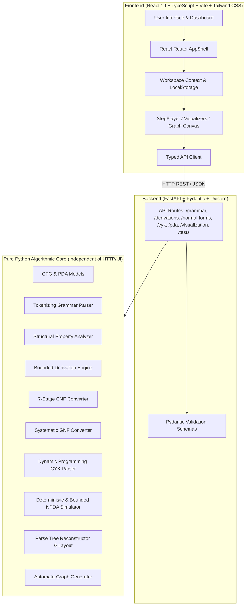

# System Architecture
## Interactive CFG and PDA Learning Tool

---

## 1. Architectural Overview

The **Interactive CFG and PDA Learning Tool** is architected as a clean, decoupled full-stack educational system designed for strict mathematical correctness, interactive real-time visual feedback, and local-first execution.

---

## 2. Decoupling & Algorithmic Independence

All formal language operations are implemented in pure Python modules under `backend/app/core/`:
- **Independent Testing**: Core algorithms have zero dependency on FastAPI or HTTP requests, enabling automated verification via unit tests.
- **Deterministic Transformations**: Functions are pure; for a given input grammar, the same canonical normal form or parsing table is computed without relying on external APIs or non-deterministic heuristics.
- **Trace Recording**: Every algorithm yields an explicit step-by-step trace capturing intermediate sentential forms, transformation stages, split points, and stack operations.

---

## 3. Data Flow

1. **Grammar Input**: User enters raw production rules or loads a sample.
2. **Parsing & Validation**: The backend lexer tokenizes symbols into Non-Terminals ($V$) and Terminals ($\Sigma$). Fixed-point algorithms compute nullable, unit, generating, and reachable symbols.
3. **Normal Form Conversion**:
   - CNF converter executes a 7-stage pipeline and verifies output against an independent CNF validator.
   - GNF converter applies ordering, left-recursion elimination, and back-substitution.
4. **CYK Parsing**: The triangular dynamic programming table is computed in $O(n^3 \cdot |P|)$ time with backpointers.
5. **PDA Simulation**: The 7-tuple automaton is simulated step-by-step, generating configurations `(state, unconsumed_tape, stack_contents, applied_transition)` with acceptance checks.
6. **Visualization**: Tree and automata graphs are computed with coordinate layouts and rendered via interactive SVG with zoom, pan, and SVG export.
