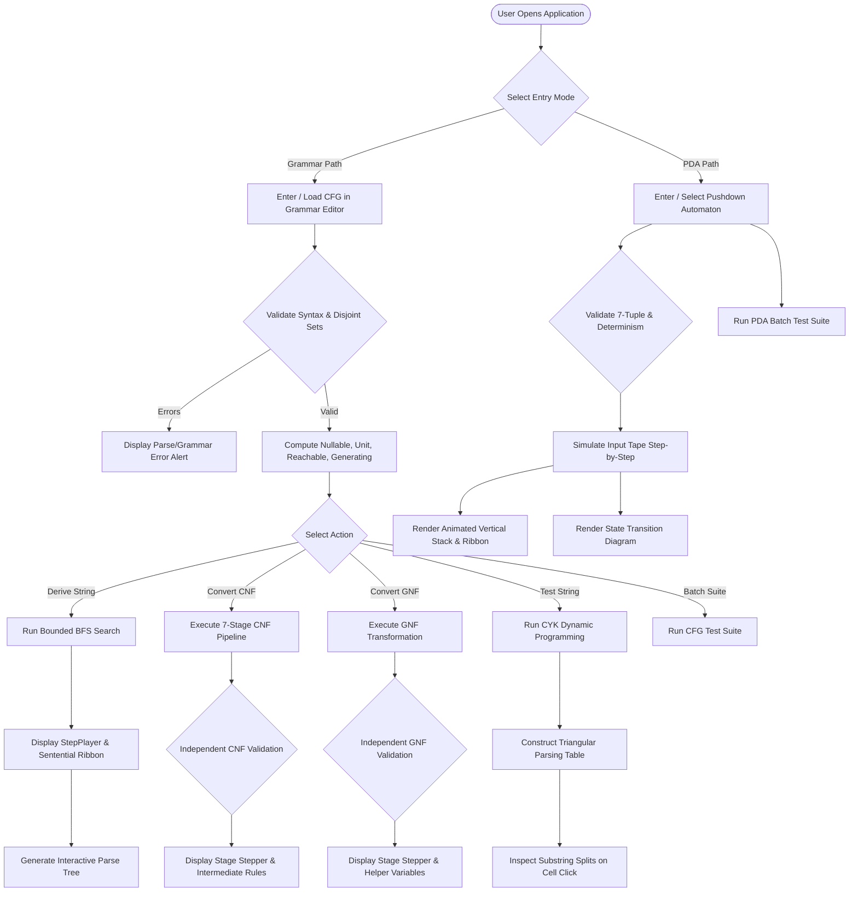
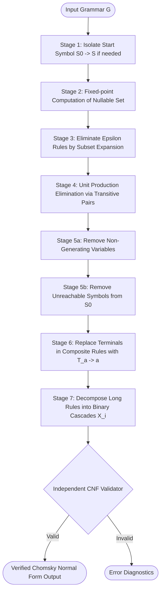

# Algorithm Flowcharts
## Interactive CFG and PDA Learning Tool

---

## 1. Overall Application Lifecycle & Workspace Flow



---

## 2. Chomsky Normal Form (CNF) 7-Stage Conversion Pipeline



---

## 3. Greibach Normal Form (GNF) Conversion Pipeline

```mermaid
flowchart TD
    GNFStart([Input Grammar G]) --> Simplify[Simplify Grammar via CNF Base]
    Simplify --> OrderNTs[Order Non-Terminals: A1, A2, ..., Am with S0 = A1]
    OrderNTs --> ForwardLoop[For i = 1 to m: Substitute Aj for j < i]
    ForwardLoop --> DetectLeftRec{Direct Left Recursion on Ai?}
    DetectLeftRec -->|Yes| ElimLeftRec[Introduce Helper Bi: Ai -> beta | beta Bi, Bi -> alpha | alpha Bi]
    DetectLeftRec -->|No| NextForward[Continue Forward Pass]
    ElimLeftRec --> NextForward
    NextForward --> BackSub[Back-Substitution: For i = m-1 down to 1, substitute leading non-terminals]
    BackSub --> HelperSub[Substitute leading non-terminals in Bi rules]
    HelperSub --> TrailingTerminals[Replace trailing terminals with helper rules T_a -> a]
    TrailingTerminals --> GNFCheck{Independent GNF Validator}
    GNFCheck -->|Valid| GNFDone([Verified Greibach Normal Form Output])
    GNFCheck -->|Invalid| GNFFail([Error Diagnostics])
```

---

## 4. Cocke-Younger-Kasami (CYK) Membership Testing Flowchart

```mermaid
flowchart TD
    CYKInput([Input String w and CNF Grammar G]) --> LenCheck{Is String Empty?}
    LenCheck -->|Yes| EpsilonCheck{Does Grammar contain S0 -> ε?}
    EpsilonCheck -->|Yes| AcceptEps([Accept ε])
    EpsilonCheck -->|No| RejectEps([Reject ε])

    LenCheck -->|No| Tokenize[Tokenize w into terminals a1, a2, ..., an]
    Tokenize --> BaseLevel[Base Level l = 1: For each a_i, T[1, i] = { A | A -> a_i in P }]
    BaseLevel --> LoopLength[For substring length l = 2 to n]
    LoopLength --> LoopStart[For start index s = 0 to n - l]
    LoopStart --> LoopSplit[For split point k = 1 to l - 1]
    LoopSplit --> MatchRules[Lookup binary rules A -> B C where B in T[k, s] and C in T[l-k, s+k]]
    MatchRules --> RecordEvidence[Add A to cell T[l, s] and record split evidence]
    RecordEvidence --> SplitsDone{More splits for cell?}
    SplitsDone -->|Yes| LoopSplit
    SplitsDone -->|No| CellsDone{More cells for length l?}
    CellsDone -->|Yes| LoopStart
    CellsDone -->|No| LenDone{More lengths l <= n?}
    LenDone -->|Yes| LoopLength
    LenDone -->|No| Decision{Is Start Symbol S in Top Cell T[n, 0]?}
    Decision -->|Yes| CYKAccept([String ACCEPTED: Construct Parse Tree])
    Decision -->|No| CYKReject([String REJECTED])
```

---

## 5. Pushdown Automata (PDA) Simulation Loop

```mermaid
flowchart TD
    PDAStart([Start: Configuration (q0, input, [Z0])]) --> CheckImmediate{Acceptance Condition Satisfied?}
    CheckImmediate -->|Yes| PDAAccept([String ACCEPTED])
    CheckImmediate -->|No| QueueInit[Initialize BFS Queue and Visited Configuration Set]

    QueueInit --> QueuePop[Pop Configuration: (state, input_pos, stack)]
    QueuePop --> HaltCheck{Input Consumed & Stack/State Valid?}
    HaltCheck -->|Yes| PDAAccept

    HaltCheck -->|No| MatchTrans[Find Applicable Transitions Matching Current State, Stack Top, and Input/Epsilon]
    MatchTrans --> AnyTrans{Applicable Transitions Found?}
    AnyTrans -->|No| QueueEmptyCheck{BFS Queue Empty?}
    AnyTrans -->|Yes| ForEachTrans[For each transition: delta(q, a, X) -> (p, gamma)]

    ForEachTrans --> UpdateStack[Pop X, Push gamma in reverse order so top is first]
    UpdateStack --> AdvanceTape[If input consumed, input_pos += 1; if epsilon, position unchanged]
    AdvanceTape --> StateCheck{New Configuration Satisfies Acceptance?}
    StateCheck -->|Yes| PDAAccept
    StateCheck -->|No| VisitedCheck{Configuration in Visited Set?}
    VisitedCheck -->|No| Enqueue[Add to Visited Set & BFS Queue]
    VisitedCheck -->|Yes| NextTrans
    Enqueue --> NextTrans{More applicable transitions?}
    NextTrans -->|Yes| ForEachTrans
    NextTrans -->|No| QueueEmptyCheck

    QueueEmptyCheck -->|No| QueuePop
    QueueEmptyCheck -->|Yes| PDAReject([String REJECTED: All exploration paths exhausted])
```
